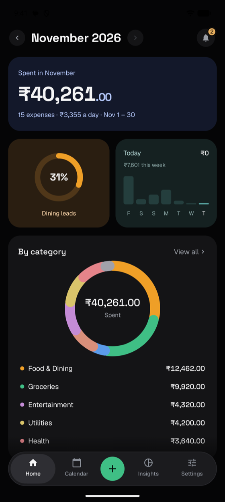
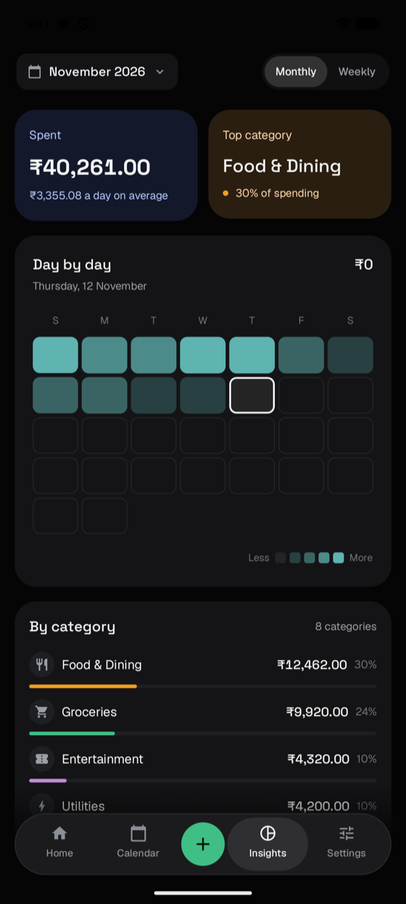
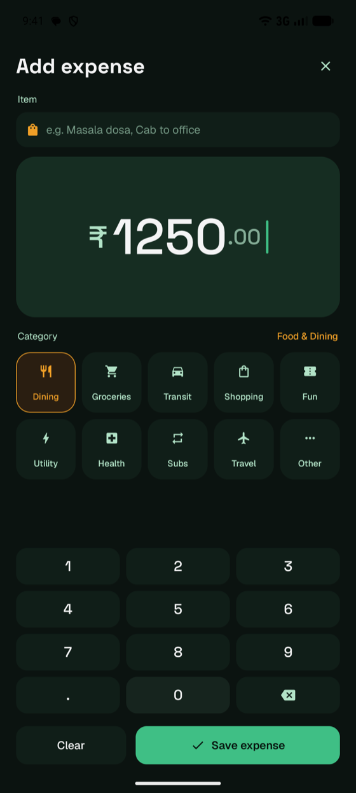
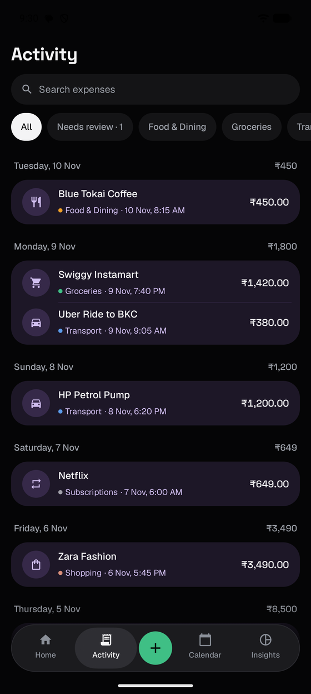
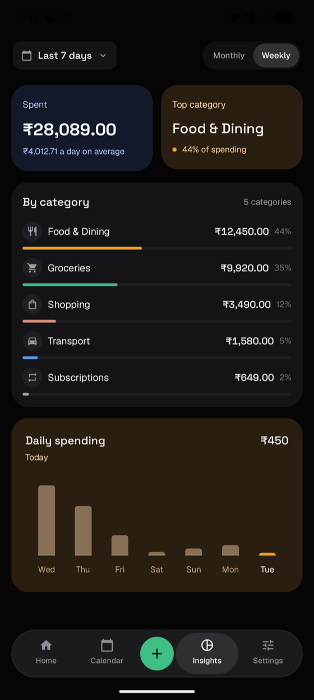
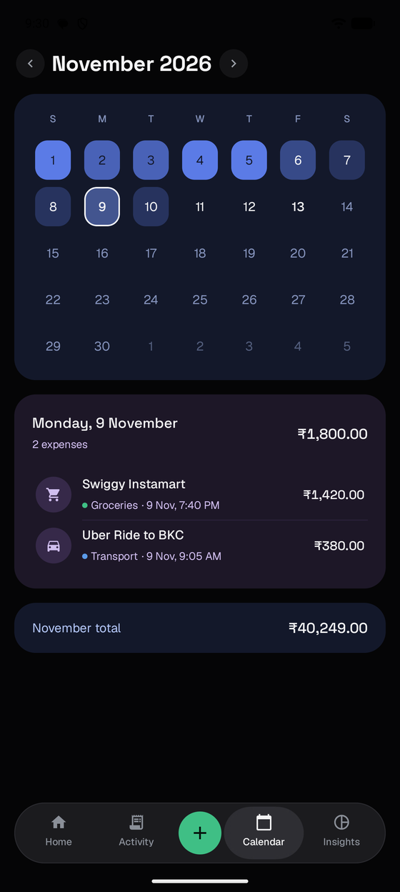
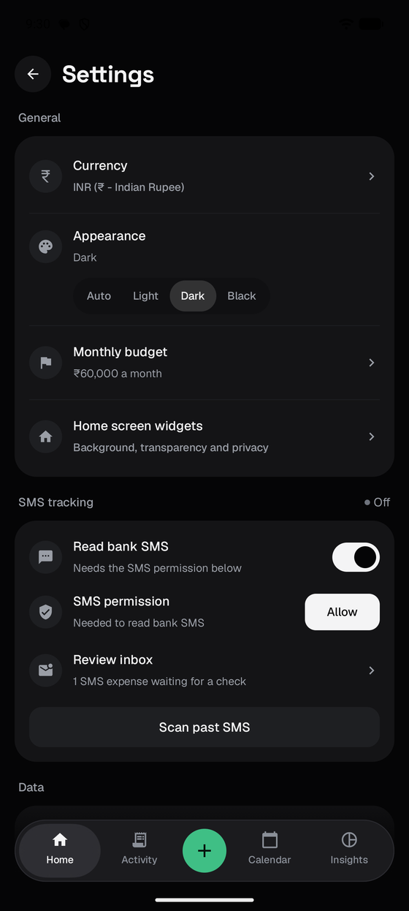
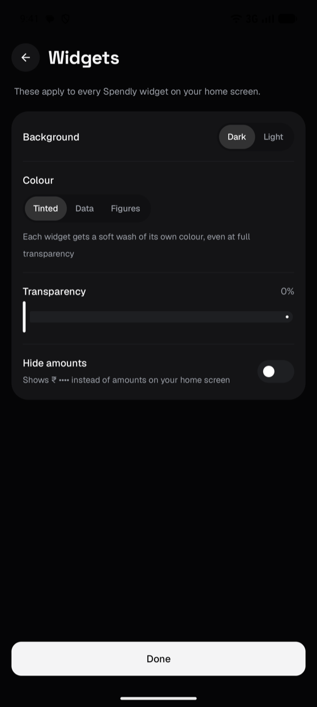
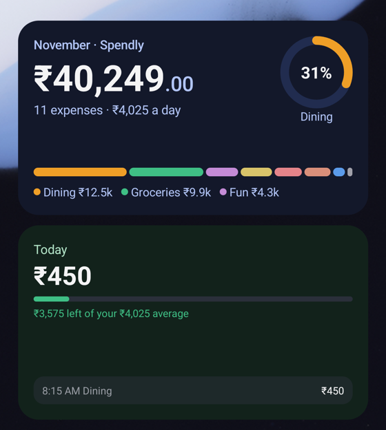

# Spendly

Spendly is a native Android expense tracker that keeps everything on your phone. There are no accounts, no cloud sync and no analytics, and the app does not request the internet permission, so your spending data cannot leave the device.

It is built with Kotlin, Jetpack Compose and Room. It can read debit alerts from bank SMS messages on the device and turn them into expenses, exports to CSV, and ships five home screen widgets.

<p align="center">
  
  &nbsp;
  
  &nbsp;
  
</p>

## Contents

- [Features](#features)
- [Screenshots](#screenshots)
- [Privacy](#privacy)
- [Tech stack](#tech-stack)
- [Project structure](#project-structure)
- [Getting started](#getting-started)
- [Testing](#testing)
- [Design notes](#design-notes)

## Features

**Tracking**
- Add an expense in one screen: an item name, a date, an amount keypad and a category. The same screen edits or deletes an expense later, and a delete can be undone for a few seconds.
- Say who an expense is for: just you, a split bill where only your share counts, something someone will pay you back for, or something already paid back. Home shows how much is still owed to you, and Activity marks it paid in one tap.
- One currency per install, chosen in Settings from INR, USD, EUR, GBP and others.
- An optional monthly budget, with what is left of it shown on Home.

**Seeing where the money goes**
- Home opens on the current month, with arrows to step through months and a month picker for longer jumps. It shows the month's total against the budget, a tappable week tile, the three biggest categories and recent expenses.
- Activity lists every expense by day, newest first, with day totals, search and filters for category and for expenses that need review.
- Calendar shows a month grid with each day shaded by how much was spent, and the expenses for the selected date. An expense can be added straight onto a past day.
- Insights has a six-month or seven-day trend chart with the category breakdown. In Weekly mode a grid in the style of GitHub's contribution graph shows the week by day and time of day.

**Bank SMS**
- Incoming SMS, and the last 90 days of the inbox on request, are parsed on the device with regular expressions. Only debits that name an account (`a/c`, `acct` or `account`) are recorded. Credits, card and wallet alerts, FASTag messages and texts from ordinary phone numbers are skipped.
- Common Indian merchants are categorised automatically, and changing a payee's category is remembered for its next SMS.
- Expenses Spendly is unsure about are marked for review and can be confirmed with one tap, or all at once.
- A notification confirms each recorded expense, and tapping it opens that expense.

**Your data**
- Export every expense to a CSV file, and import it back on this or another phone. Importing the same file twice adds nothing.

**Home screen widgets**

Five widgets, all sized to fill their space on launchers such as One UI:

| Widget | Shows |
| --- | --- |
| Overview | The month's total, a category split bar and its legend with amounts |
| This week | Spend for each of the last seven days, with a badge against the week before |
| Recent | Latest expenses with amounts and times, a review count and payees from SMS |
| Today | Today's spend against your daily average, with a bar that turns amber and then red as you near and pass it |
| Quick add | Shortcuts that open Add expense with a category chosen |

Widget settings apply instantly and cover a dark or light base, transparency, three colour styles (Tinted, Data and Figures) and an option to hide amounts.

**Appearance and motion**
- Themes: Auto, Light, Dark and Black (true black for OLED screens).
- Add expense grows out of the + button, the total counts up to its new value, a saved expense folds the Save button into a tick, and a new row slides into the list. All of it follows the system animation setting.

## Screenshots

<table>
  <tr>
    <td align="center"><br>Home</td>
    <td align="center"><br>Activity</td>
    <td align="center"><br>Add expense</td>
  </tr>
  <tr>
    <td align="center"><br>Insights, monthly</td>
    <td align="center"><br>Insights, weekly</td>
    <td align="center"><br>Calendar</td>
  </tr>
  <tr>
    <td align="center"><br>Settings</td>
    <td align="center"><br>Widget settings</td>
    <td align="center"><br>Overview and Today widgets</td>
  </tr>
</table>

The screenshots use the demo expenses from Settings, Load sample data.

## Privacy

- No `INTERNET` permission, no analytics, no accounts and no remote services.
- Expenses live in a local Room database and preferences in the app's private storage. Android backup and device transfer are switched off for the app, so nothing is copied to a cloud account.
- The only permissions are `READ_SMS` and `RECEIVE_SMS`, used to parse bank debit alerts locally, and `POST_NOTIFICATIONS`, used only for the alert shown when an SMS expense is recorded. SMS is read only after you grant the permission in Settings, and a switch there turns it off again. Message text is never written to the system log.
- Expenses can be exported to a CSV file from Settings, and all data can be deleted there too.

## Tech stack

| Area | Choice |
| --- | --- |
| Language | Kotlin 2.3 (JVM toolchain 17) |
| UI | Jetpack Compose, Material 3 |
| Widgets | Jetpack Glance |
| Architecture | MVVM with a repository, Kotlin Coroutines and Flow |
| Storage | Room 2.7 and SharedPreferences |
| Navigation | Navigation 3 with typed `NavKey` destinations |
| Build | Gradle 9, Kotlin DSL and a version catalog |
| Android | `minSdk` 26, `targetSdk` 35, `compileSdk` 36 |

## Project structure

```
app/src/main/kotlin/com/example/spendly/
  MainActivity.kt, Navigation.kt      Single activity, screen routing and transitions
  SpendlyApplication.kt               Database, repository, preferences and widget refresh
  data/                               Room entities, DAO, repository, preferences, sample data
  sms/                                SMS parser, reader, receiver and notifier
  widget/                             Glance widgets, their data and the widget settings screen
  ui/
    home/  calendar/  insights/       Main screens
    activity/  categories/  settings/ Lists and preferences
    transaction/                      Add and edit expense screens
    components/                       Dock, charts, rows, reveal and motion helpers
    theme/                            Colours, typography, theme tokens and motion
```

`CLAUDE.md` holds the detailed conventions for the codebase: design tokens, motion, widget rules and the gotchas that have come up.

## Getting started

### Requirements

- Android Studio (current stable) or the command line
- JDK 17
- Android SDK Platform 36

### Build and run

```bash
# Debug build, for an emulator
./gradlew assembleDebug
./gradlew installDebug
adb shell am start -n com.example.spendly/.MainActivity

# Release build for a phone (signed with the debug key, so it installs over a debug build)
./gradlew assembleRelease
```

Output:

- `app/build/outputs/apk/debug/app-debug.apk`
- `app/build/outputs/apk/release/app-release.apk`

The release build starts faster and animates more smoothly than debug, so use it to judge performance.

### GitHub Actions

The workflow in `.github/workflows/android-build.yml` builds a debug APK and runs the unit tests. It runs on demand from the Actions tab and not on every push.

## Testing

```bash
./gradlew testDebugUnitTest
```

The unit tests cover the SMS parser (including bank alert formats that must be skipped, sender filtering and categories), CSV export and import, the sample data and the period picker.

## Design notes

- A dark bento layout: a near-black background with opaque tiles, 24 dp corners and no borders. Each kind of tile has its own tint (navy for totals, amber for trends, sky blue for lists, green for Add expense), and charts, settings and keys stay neutral.
- Space Grotesk for figures, Geist for text, sentence case throughout, and vector icons instead of emoji.
- A floating pill navigation bar with a green add button. Content fades out above it, and every scrolling screen ends with enough room to clear it.
- Motion is short and calm: arrivals slow into place, exits speed away, and only touch feedback springs.
